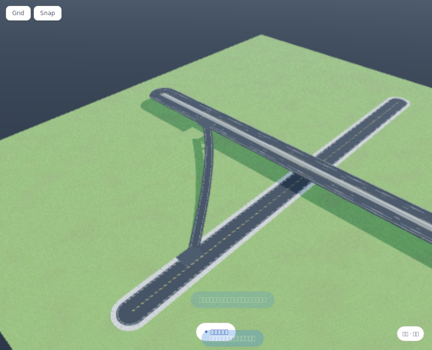

# 匝道路线与地面近侧汇入口修复

2026-10-27，1.7.0 后续开发修复。源码、网页、离线 HTML 和桌面前端已更新；**没有重新发布 Windows 安装包，之前下载的 1.7.0 不包含本修复及中央带闪烁修复。**

## 问题与修改

截图中的大 U 来自两个因素：中部接点的切向分量始终取道路正向，可能背离目标；短陡坡又允许横向偏移到直距的 2.2 倍来凑长度。地面端则沿用了整幅普通 T 口，产生大块铺装和斑马线。

- 接点切线按另一接点所在的几何方向选正负。仅允许不超过直距 20% 的小幅避障，沿目标的投影不得明显倒退；路线长不得超过直距的 1.35 倍，高速相关连接累计水平转角不超过 135°。
- 保持 18% 纵坡、最小转弯半径、自交、地形边界和碰撞限制。整路标记沿八分站位及最近位置搜索，比较可行路线；明确标出的点不沿路搬走。无法满足限制时拒绝，不制造大环或留下半成品。
- 高速相关连接采用固定 3.5m 单车道，无步道；每侧路肩按目标方向可用宽度缩至 0–0.75m。方向宽不足 3.5m 时拒绝，不拉伸车道硬塞。
- 普通双向沥青／混凝土街道新增独立 `streetMerge` 近侧半幅汇入口，不再把整条双向街道铺成大 T 口。保留中心线和对向路面；12m 示例街道的路口臂长上限约 5.1m，不生成斑马线或停止线。
- 有高差的街道汇入口保留原道路／匝道路面，仅清理接头的路缘、标线等侧带，避免混合高度场压低坡尖。平坦口继续紧凑裁切。高速口仍保留中央带和对向车道的原有保护。
- 只有自动匝道的单向类型使用 merge 样式，手动改成双向普通路后恢复普通路口规则；退出匝道编辑后，新画的普通道路不继承 merge 标记。

“顺向”是接点间的几何进度约束，不是交通流方向仿真；本功能仍是布景近似，不提供工程级交通组织或任意两点必可连接的保证。

## 旧连接如何更新

选中之前自动生成的连接，在「自动连接道路」中点击 **重新生成这条连接**。按保存的两个接点重算，不静默更改工程内已有曲线。

- 道路 ID、名称和机位目标保持；一次撤销可恢复原来的大 U，支持重做及保存恢复。
- 失败、源道路锁定或空间不足时保留原曲线及撤销栈。
- 若要让程序沿道路重新选接点，重新标记 A/B 两条路再生成。

## 验证

新增 `npm run test:ramp-routing`，浏览器专项在三种入口均通过：网页、断网 `file://` 离线 HTML、实际桌面构建的 CSP 预览。覆盖：

1. 截图式高架高速／地面街道的四象限及标记反序，共 8 组：无大 U，长度／前进方向／转角受限，2 个接头，街道近侧口不侵对向，无斑马线和停止线。
2. 缝口射线采样，高度误差阈值保持 0.16m；网页 8 组最大误差约 0.071m，没有通过放宽阈值掩盖坡尖问题。
3. 整路搜索选站、短陡连接原子拒绝。
4. 实际点击重生成按钮：version 1 大 U 变成 version 2 匝道，稳定 ID 与机位目标，一步撤销／重做、连接排在源道路之前的保存恢复。
5. 匝道改宽后仍为 merge；新画道路不继承 merge；源道路锁定后重生成被拒且工程／撤销栈不变。

另通过自动连接原浏览器回归、40 组三维接入纯测、60 组路口纯测、12 组三维网络浏览器回归、绿色高度柄交互、近侧高速口／曲线高速保护、12 组锐角与坡度场景，以及中央带唯一顶面／12 视角绘制顺序负对照回归。`npm run all`、`npm run build:desktop` 通过。

证据：[网页](road-ramp-routing-evidence/web.json)、[离线](road-ramp-routing-evidence/file.json)、[桌面 CSP](road-ramp-routing-evidence/desktop-csp.json)。平台均为 **Linux Chromium 软件 WebGL**，不是用户 Windows／4070Ti 原生验收，也不是新 Windows 安装包测试。

