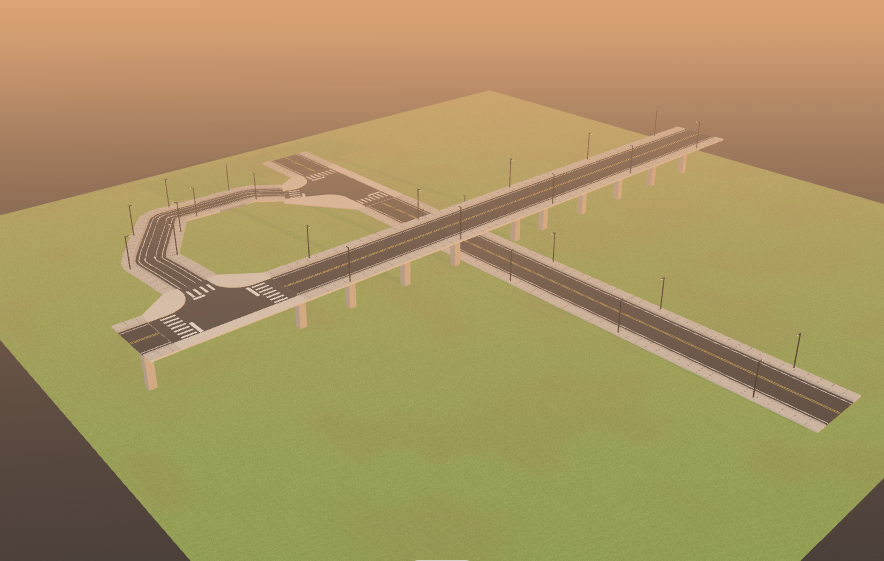
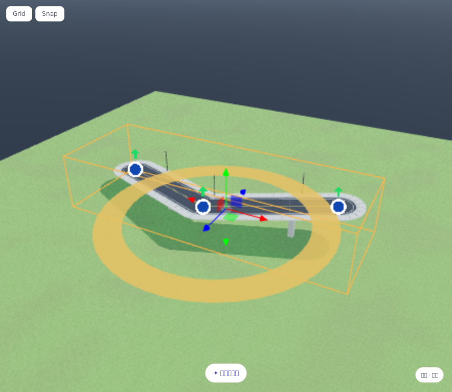

> **1.7.0 新增**：[标记 A/B 自动连接、紧凑锐角口、车道数／固定车道宽／路肩／步道独立控制](road-automatic-connections.md)。下述原有单点高度编辑继续可用。

# 三维道路：立交、高架、升降匝道与路灯

适用于 1.6.2；网页、离线 `previz-lab.html` 与 Windows 桌面前端使用同一套道路编辑功能。

上图为本次真实编辑器渲染示意，不是生成图片，也不是结构 / 净空工程验收。

## 搭建一个简单立交

1. 画好下层道路，完成绘制并按 Esc 退出画笔。
2. 画第二条交叉道路，完成后选中它。在右侧「道路参数」找到「起 / 终标高 m」，把终点值设为例如 **8**，点 **设为高架（终点标高）**。
3. 第二条道路全部控制点采用该绝对标高，变为固定标高模式。上下层保持独立，不会在交叉位置挖出平交路口；自动桥墩会尝试避让下层道路和建筑，受阻处留空，不强行穿插。
4. 再画一条连接支路，可先用单向路和较窄的车行宽度。将首尾 X/Z 放在上下层主路需要接入的位置，设起点标高如 **0.02**、终点标高如 **8**，点 **设为升降匝道**。起终标高应与对应主路一致；同高接入才生成路口。
5. 使用「道路检查 · 标高 / 纵坡 / 净空」检查坡度、下穿空间和接头；如果坡度太大，延长匝道或降低高差。

标高是**道路设计基准的绝对 Y 坐标**，不是离地净高，也不是路面铺装顶面；铺装、路缘在此基础上有厚度。贴地道路的实际设计标高取决于地形。道路并非自动结构设计，8 m 只是示例，不保证任何指定车辆的法定净空。

## 逐点调高与修改路线

上图为 1.6.1 实际编辑器截图；**每个蓝点正上方的小绿色 ↑** 是单点高度柄，中心的大坐标轴仍是整体变换。截图使用 Linux 回归的低渲染分辨率，不是 Windows 清晰度或性能验收。

- **单点直接升降**：选中道路，直接上下拖动**该蓝色圆点正上方的小绿色 ↑ 箭头**，不需要按 Shift，只改变这一个点的 Y，X/Z 和其他点保持不变。不是道路中心的大坐标轴，也不是「设为高架」整路预设。松手提交，一次可撤销；俯视图同样可用。贴地道路首次改 Y 会切换为固定标高，并保留未拖点当前实际高度。
- **平面拖点**：拖蓝色圆点修改 X/Z；固定标高道路保留该点原 Y。原来的 **Shift + 拖蓝点**仍可单点调高低。
- **数值输入**：展开「逐点坐标与标高」，输入每个点的 X / Y / Z；输入后离开输入框提交。修改 Y 会切换为固定标高。
- **持续编辑**：点「编辑路径圆点（拖动调整）」；面板显示当前草稿、逐点坐标、预设、完成和取消按钮。可继续加点、拖点和调倒角；完成编辑为一步操作。取消 / Esc 恢复原路、原设置和相机目标，不额外留一个删除道路的撤销项。
- **直接绘制高架**：开始画路后，在面板将「贴地绘制」改成「固定标高 / 三维路径」，无控制点时输入新路标高，再在视口放点。
- **高架预设**将已有点设为同一标高；**匝道预设**按水平里程增加过渡点，用 smoothstep 标高分布由起点过渡到终点，保留原始平面转角和端点。它是采样折线，不是工程级竖曲线解算器；需要时继续调点、平滑倒角或重新设计路线。
- 锁定道路不能改点、预设、桥墩和路灯；先解锁。已有未完成的道路需先完成或取消，避免隐式丢失草稿。

## 高速近侧接入与锐角路口

**1.6.2 修正带三维夹角的端点接入**：匝道端点进入目标路幅且端点设计高度吻合时，即使近侧车道轴线采样处已经因纵坡而变低，也会生成接头；允许 0.15 m 的端点坐标 / 铺装舍入差，路口铺装按目标标高衔接。该容差只针对有限路幅内的接入端点，不是全局放宽高差；远处端点、越出目标道路末端、上下层真正错开的中段交叉不会据此连通。短匝道两端的接头范围也受相邻路口间距约束，防止两块铺装互相盖住。

- 普通道路 / 单向路作为匝道接到高速时，只接入靠近支路的那一幅车道；保留中央隔离带、防撞墙和对向车道，不再把整幅高速挖成平交口。高速支口不生成斑马线 / 停止线，近侧护栏在实际接入口打开。
- 一条普通路画过整个高速时，两侧各生成独立接入口，支路在中央带范围截断，**不能穿过中央隔离带掉头或直穿**。需要跨越时请逐点设置上下层高差，形成跨线桥 / 立交，再以普通道路作匝道连接。
- 两条高速道路新画同高交叉会拒绝完成并提示改标高，不会凭空打开中央带；草稿保留，可继续调点或取消。旧工程中已有这种布局不会被删除，面板会提示整改。
- 锐角、短支路、宽窄道路的路口断面统一使用水平单位切线，接头不会因纵坡缩窄；路口出口受真实端点约束，不能延伸到并不存在的道路上。带坡接头的铺装也会随各接入臂的设计标高过渡，而非仍铺一块水平板。
- 这些仍是场景搭建几何，不是交通法规、可行驶车道连接、结构设计或任意极端曲率的工程保证。

## 每条路独立的路灯分布开关

选中已完成道路，在「道路参数」里设置：

- **路灯分布**：开启 / 关闭。旧工程及新路默认关闭，不凭空改变已有场景。
- **分布位置**：道路两侧 / 行进方向左侧 / 行进方向右侧。左右按控制点排列方向定义。
- **路灯间距**：8–80 m；拖动结束提交，沿用共用滑块防断触机制。默认 24 m；道路两端留出至少 6 m，短于 12 m 的路不布灯。

附属灯跟随道路的路线与高度，尽量避开平交路口和会穿过灯杆的其他道路、回环段。高速道路布在护栏内侧的路肩，普通车行路布在人行道外侧；小径/碎石路沿路缘。极长道路每侧最多 256 盏，达到上限时增加实际间距；面板显示实际放置盏数。

关闭只删除这条路的**附属路灯**，不删除从模型库手动放置的灯，也不影响其他道路。道路类型、宽度、路径、标高修改，以及撤销、重做、工程保存重载都会保留开关、间距与分布侧别；已有本地对话修改道路宽度或路径时也保留手动设置的桥梁与路灯参数。

灯具与模型库的 Street Lamp 使用同一构建器，灯面随光影的自发光强度变化。采用实例化网格，不为每盏增加实时点光源；因此这里是路灯分布与发光外观，不是逐灯照明仿真。需要真实照亮地面时，可另外放置受现有灯光预算管理的手动灯具。

## 实现与验证要点

- 固定标高道路按纵向站点对网格做竖向剪切后斜接，而非将等长水平件直接俯仰，避免坡段缩短、变坡处整幅端面不接；自身上下交叠的道路也保留各段标高，不把所有顶点按 X/Z 投影到同一层。
- 路口检测枚举同对道路的多个平面交点并逐处检查高度；回环匝道先下穿、后接入同一主路时，不再只检查全局最近的一处。交点细化逐步收敛。
- 匝道桥墩承托随纵坡剪切；对本路使用实际承托体积检测，不以斜承托的巨大轴对齐包围盒误判撞到自身路面。对其他道路/建筑仍采用保守全体积避让；关闭地形显示时以 Y=0 平地生成桥墩。
- 路灯不充当道路路面、桥墩避让的整条大包围盒，也不会因为灯具组覆盖一大片区域而误删植被或影响道路净空诊断。

三维端点接入专项：`npm run test:road-3d-contact`，40 组端点 / 方向 / 道路顺序纯测试和 12 组高架—坡匝道—下层路网的实际接头、缝口射线、中央带、下穿分离，以及增量补画 / 撤销 / 重载测试。

新增纠错专项：`npm run test:road-junction-corrections`，覆盖无修饰键真实单点升降、俯视 / 贴地、蓝点 XZ、草稿取消、锁、双侧 / 双绘制顺序高速口、曲线中央带与对向车道、锐角短路及带坡接头射线。

纯测试：`node test/road-elevation.test.mjs`。浏览器专项：`npm run test:road-elevation`；可设置 `TEST_URL` 测桌面 CSP 前端、`TEST_FILE_URL` 测断网离线 HTML。测试包含真实鼠标高程拖动、实际按钮与数值输入、原生 range 拖动、分层射线、匝道双端接入、回环与自身分层、桥墩、路灯独立性、保存重载、撤销重做、锁和相机目标。

这些浏览器测试不是用户原生 Windows 鼠标硬件、4070Ti 性能或真实 GGUF 推理验收；沿用原本的离线模型与安装边界，不会下载、改名、合并或移动用户的 GGUF 分片。
