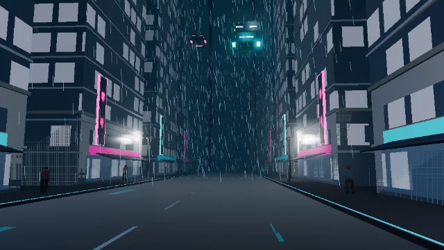
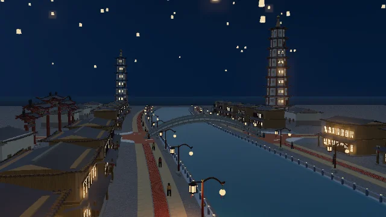

# 两套夜景示例场景

2026-10-20 · 本地程序化布景，无模型服务调用、无外部贴图/CDN。

## 打开与使用

1. 保持或切到 **Scene** 页，点顶栏 **场景 → 示例场景**。
2. 在带实景缩略图的卡片中选择：
   - **霓雨深城 · 悬浮航道**
   - **万家灯火 · 望河古城**
3. 默认暂停在布景的开场视角；按 **空格**播放 30 秒时间轴，或拖动时间轴查看动作。
4. 切到 **Camera** 页可选预设机位，按 **C** 进入/退出机位取景。
5. **场景 → 保存工程** 下载 `.previz`，用 **打开工程**恢复。载入模板会替换当前场景；先保存重要工程，也可用 **Ctrl+Z** 一步撤销。

不会自动覆盖用户已恢复的工程。DEV、静态构建和根目录 `previz-lab.html` 单文件离线版都有同一入口，缩略图也包含在离线版中。加载新示例会开启材质与光影、隐藏网格和路径辅助线，避免继承之前的灰模/无光照检查状态；仍可在视图菜单手动切换。

## 霓雨深城 · 悬浮航道

- 开场位于街区内部，视点高 **1.75m**，仰望高层建筑夹出的狭窄天空，不是鸟瞰。
- 两侧成排高楼、沿街裙房和远处第二层天际线；青色/品红霓虹招牌、分户夜窗、湿街视觉细节。
- **9 辆悬浮车**：7 辆在不同高度的纵向航道穿行，2 辆横穿塔楼间隙；带空中步廊及消防梯布景。
- **20 位行人**在两侧步道往返。
- 线状雨丝与浓雾同时存在，霓虹配适度 Bloom。
- 91 个库模型、3 个机位：雨巷人眼缓推 / 楼隙悬浮航道 / 雨城纵深全景。

## 万家灯火 · 望河古城

- 河道沿 S 形走势贯穿小城；**真实下凹河床 + 独立河流水面**，不是在平地上放一条蓝色道路。
- 两岸道路沿河道采样布置，临河商楼朝水，石岸栏杆和宫灯连续分布；第二进是街坊院落。
- **30m 石拱桥**横跨河流，中轴线道路分别接至桥的两端，没有一条平路横穿水面、盖住拱桥。
- 牌楼旋转为横跨中轴道路，中间开口允许道路通过；两座远景佛塔带暖窗，东塔旁留出无建筑重叠的场地。
- **108 盏孔明灯**分成 3 个可编辑灯群缓慢漂移；沿岸 24 位游人，桥上 4 位游人沿拱面高度往返，不随河床下沉。
- 暖窗、宫灯、窗火佛塔和水面碎金；灯具使用现有实灯预算，不是为每盏灯开启一个实时光源。
- 162 个库模型，另有 4 条原生道路及 2 个自动生成路口；4 个机位：河街望桥与佛塔 / 中轴穿牌楼望石桥 / 灯河双岸全景 / 桥上灯市人眼。

## 实现与边界

- 新资产只追加在 **示例布景（新增）** 分类：悬浮汽车、霓虹灯牌、雨夜街区地面、空中步廊与消防梯、滨河石岸栏杆、古城暖窗格栅、灯河碎金倒影。原模型库没有为这次布景而删减或替换。
- 模板入口：`src/showcase-scenes.js`；新几何：`src/showcase-assets.js`。参数和路线都是本地数据，可继续编辑，不依赖 AI 网关。
- 精确布景不做自动贴地/自动地形跟随，避免把飞车压回地面、把拱桥游人吸进河床。原来的一般模型添加逻辑保持原样。
- 保存包含地形精确高度、河道、道路、光影、天气类型/样式/种子、机位、镜头视场角、辅助显示状态和动作路线。实时雨滴相位不保存；重开时按种子初始化。
- 路线为预先编排的循环，不是交通 AI、导航或通用碰撞求解。Mover 使用样条，`arc:false` 仅表示不用弧长重映射；直线段已加密，约束楼隙转角处的样条外扩。加载时修复了弧长选项被重建默认值覆盖的问题。
- 孔明灯是成组漂移，不是逐盏风场/燃烧模拟。湿街和水面碎金是人工布景效果，**不是 SSR 或光线追踪反射**。属于适合运镜/动作参考的程序化风格场景，而非影视级写实成片。
- 参考包沿用原先的天气冻结策略；本轮没有新增长视频天气/全场性能验收，不把最后一个后处理 pass 的 draw call 当成全场统计。

## 本轮验证

- `node test/showcase.test.mjs`：253 个模型参数、河道/中轴/牌楼/塔院位置；所有天气类型的 points/streaks 配置、有限坐标、确定性种子（含 0）通过。
- `bash test/withchrome.sh node test/showcase-regression.mjs`：通过真实菜单和卡片载入两景、缩略图加载及弹层边界、零缺失资产/主体；60 个动态对象合计 **14,460** 个路线样本；飞车对塔楼保守包围盒留距检查、机位采样、时间轴移动、保存重载、精确河床/道路、撤销重做与无天气字段旧工程兼容。
- 同一浏览器回归在 `TEST_FILE_URL=file:///…/previz-lab.html`、浏览器断网模式下通过，非 DEV 专用测试钩子。
- AI 场景底座、候选/撤销/回滚及安全回归通过；参考包 UI 下载回归通过；单文件断网参考包正常/灰模、关键帧深度/遮罩、取消/失败清理与结果版本回归通过。没有调用真实模型推理。
- `npm run all`：静态部署产物与单文件版构建通过。Vite 仍有既有的大 chunk 提示；本轮没有宣称解决全部构建体积问题。

测试图和详细运行 JSON 在忽略版本控制的 `.shots/`；仓库仅保留两张小体积实景缩略图，不纳入大截图/测试视频。

结构化验收记录及单文件哈希：[showcase-evidence/manifest.json](showcase-evidence/manifest.json)。

## 雨层高度修正（2026-10-20）

雨/暴风雨不再限制在世界坐标 `0–30m` / `0–35m` 内。降水改为围绕当前镜头的有界粒子场，随镜头的水平、垂直移动循环回收越界粒子；仍在场内的雨滴保持世界位置，不随镜头整体平移。边界用渐隐隐藏回收盒，仰拍不会出现硬切的水平上沿。雪同步支持垂直镜头跟随；沙尘仍保留近地高度。

这是有限粒子预算的局部天气效果，不是无限范围的云层/降雨物理模拟，也未增加粒子数量或 draw call。天气类型、样式和种子的保存格式不变；参考包仍沿用原先的粒子冻结策略。

验证：`node test/weather-volume.test.mjs`，以及 DEV / 单文件断网的 `test/weather-volume-regression.mjs`。覆盖街面、80m、220m、1200m 镜头高度，雨点/雨丝与雨雪/暴风雨着色器、镜头瞬移及上下移动、世界锚定、保存重载；每种浏览器入口 16 个渲染案例，无页面或 shader 错误。`npm run all` 已重建单文件。结构化记录见 [weather-evidence/manifest.json](weather-evidence/manifest.json)。

## 从示例到一句话参数化

两套示例现在与顶栏「一句话生成」的赛博街谷／滨河古城配方共享工厂和资产规则。精选卡片保持原有黄金布景；配方按 seed、规模、密度、人车灯数量与河宽等编译新布景，可编辑、保存及一步撤销。挂接只在生成时计算；空间检查不是通用碰撞求解；布局预览是二维草图，不是 3D 候选。详见 [第一批配方说明与验收](scene-recipes.md)。

配方第二批的关系／时序能力见 [空间关系与动态约束](spatial-dynamics.md)；精选示例本身保持原有 30 秒编排，不会自动开启新时序参数。
